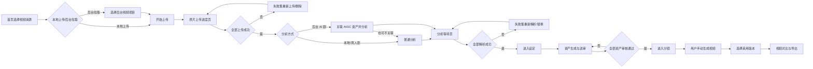

# 视频重制工坊产品方案

| 字段 | 内容 |
|---|---|
| 版本 | v3.16 |
| 日期 | 2026-06-30 |
| 状态 | 流程确认版 |
| 阅读对象 | 产品负责人、设计、研发 |
| 原型路径 | `prototype/index.html` |
| 本版调整 | 重构首页上传、AIGC 项目关联、原片分析修复、资产占位符、资产审核、分镜生成和视频导出流程 |

---

## 1. 核心定位

视频重制工坊面向短剧出海重制生产。用户上传完整短剧视频后，系统分析剧情、镜头、资产和文字内容，并把角色、场景、道具等资产转化为目标国家版本，最终辅助用户逐分镜生成重制视频。

本版重点解决三个问题：

1. VLM 视频分析成本高，必须在分析前确认素材完整，并在失败时支持单集修复。
2. 如果原剧来自公司 AIGC 短剧生产平台，应复用已有资产图和资产描述，提高资产确认准确度并减少抽帧分析成本。
3. 资产不是简单平铺列表，需要支持资产占位符与子资产状态，例如角色普通状态/西装状态、场景日景/夜景。

## 2. 主流程

## 3. 首页、上传与分析入口流程

### 3.1 首页来源选择

首页只负责选择视频来源、确认素材来源并启动上传，不直接展示 AIGC 候选项目，也不展示上传进度列表。页面提供两个来源入口：

- 上传本地视频：从本地选择短剧文件夹或单个视频。
- 拉取后台视频项目：从公司视频管理系统选择已有项目。

用户选择任意来源后，首页底部主按钮显示为“开始上传”。目标国家和生成参数可以预选，但分析方式不在素材上传前决定。

首页项目管理区只在初始首页展示。进入上传进度页后不展示项目管理区，避免用户误以为还停留在项目列表页。

### 3.2 后台项目选择

用户点击“拉取后台视频项目”后，系统打开项目选择弹窗。弹窗中的项目按生产类型区分：

- AI 剧：由公司 AIGC 短剧生产平台生产，存在可复用资产资料。
- 真人剧：视频管理系统中的真人拍摄剧，无 AIGC 资产可复用。

项目卡片展示：

- 剧名
- 剧 ID
- 总集数
- 项目组
- 更新时间
- 生产来源

选中项目后，首页只展示已选来源卡片，例如“后台项目 · AI 剧 / 真人剧”，并提示上传后再选择分析方式。

### 3.3 开始上传

用户点击“开始上传”后，进入归属“原片”节点的上传进度页面。该页面是独立页面，不是首页隐藏/展开态。

上传进度页展示：

- 当前剧集槽位
- 文件名
- 时长
- 大小
- 上传状态
- 单集操作

上传状态包括：

| 状态 | 操作 |
|---|---|
| 等待上传 | 暂停 |
| 上传中 | 暂停 |
| 上传成功 | 重新上传、删除 |
| 上传失败 | 重新上传、删除 |

原型演示中保留上传失败样例。失败时页面顶部统计显示失败数量，分析方式区域不出现；用户需要先处理失败剧集。点击失败行“重新上传”后，单集进入重新上传状态，成功后统计恢复为全部已上传，并显示分析方式选择区域。

### 3.4 上传完成后的分析方式

分析方式只在全部视频上传完成后出现：

- 本地上传：只高亮“普通分析”，“关联 AIGC 资产并分析”置灰。
- 后台真人剧：只高亮“普通分析”，“关联 AIGC 资产并分析”置灰。
- 后台 AI 剧：高亮“关联 AIGC 资产并分析”，同时保留“普通分析”作为次选项。

不关联时允许继续，但需要提示：普通分析会增加视频抽帧、视觉理解和 OCR 成本，资产准确度可能低于关联 AIGC 项目的链路。

### 3.5 返回规则

顶部左侧返回按钮在上传进度页、分析等待页和后续节点中，都应可实际点击返回到首页上传初始态。返回后清空本轮来源选择、上传状态、分析进度和分析方式，恢复首页“先选择视频来源”的 0 到 1 演示状态。

## 4. 原片分析等待页

### 4.1 独立分析 loading

用户在上传进度页点击分析方式后，才进入独立分析 loading 页面。此页面不再展示上传进度表，只展示分析任务的等待状态和进度模拟。

分析等待页展示两个加载态：

- 剧情解析转化进度：识别剧情段落、台词、镜头节奏，并转化为目标国家分镜基础描述。
- 资产解析转化进度：优先关联 AIGC 平台资产描述；未命中时通过抽帧、视觉理解和 OCR 生成资产描述。

每次点击“普通分析”或“关联 AIGC 资产并分析”都重新播放 loading 进度动画，便于演示从上传完成到分析完成的过程。分析完成后，“进入设定”按钮高亮。

### 4.2 固定剧集槽位

系统以用户最初上传确认的集数作为固定槽位。若最初上传 40 集，分析页锁定 40 个剧集槽位：

- 不允许新增第 41 集。
- 允许删除/替换某一集的视频文件，但不改变固定总集数槽位。
- 失败集只能在原槽位重新上传、替换或重新解析。

### 4.3 单集失败修复

分析失败后的单集状态包括：

| 状态 | 操作 |
|---|---|
| 解析中 | 查看进度 |
| 解析成功 | 默认锁定，不在分析等待页重复解析 |
| 解析失败 | 重新解析、本地替换、后台替换 |

后台导入或 AIGC 关联项目的视频失败时，替换方式同时支持：

- 本地上传视频替换当前集
- 从公司后台同项目 / 同剧 ID 下重新选择该集视频替换

替换时，系统校验所选视频是否疑似对应当前集数。若疑似不一致，弹窗提示用户确认后允许继续。

### 4.4 进入设定条件

必须全部剧集完成剧情解析和资产解析后，才允许进入设定。任意一集解析失败或解析中，“进入设定”置灰。

## 5. 资产设定

### 5.1 资产占位符

视频分析阶段不强行判断主资产/子资产层级，而是创建资产占位符。

例：识别到“张三”后，系统先创建角色占位符“张三”。后续分析再次识别到张三时，系统判断服装、状态、造型是否与已有子资产重复：

- 重复：归并到已有子资产。
- 不重复：新增到该占位符下，例如普通状态、西装状态、受伤状态。

用户在设定页确认哪张作为主资产图，哪些作为子资产状态。

### 5.2 AIGC 资产复用

如果关联了 AIGC 平台项目，角色和场景可以拿到原资产图和原资产描述。资产分析时，系统用视频识别出的资产名称字段去匹配 AIGC 平台资产资料。

如果没有关联，或项目是真人剧 / 外部 AI 剧，则通过视频抽帧、视觉理解和 OCR 生成原资产图与原资产描述。

### 5.3 目标国家转化

每个子资产在分析阶段同步生成目标国家版本：

- 目标国家资产名
- 目标国家资产描述

例如系统识别到“张三-西装状态”后，应同步生成“John Carter - Suit”和对应美国版资产描述。进入设定页时，用户看到的是原资产资料与目标国家描述的一一对应关系。

### 5.4 一期纠错能力

一期支持：

- 新增资产占位符
- 新增子资产
- 删除错误资产 / 子资产
- 修改名称和描述
- 选择主资产图
- 只填文字创建占位符，后续再补图

一期不支持：

- 子资产从一个占位符移动到另一个占位符
- 复杂拆分与合并

删除资产或子资产时，删除整条记录，包括原图、原描述、目标国家名称、目标国家描述和生成结果。进入分镜后，如果资产已被引用，删除规则后续再补充。

## 6. 资产生成与送审

资产必须先生成目标国家版本图片，才能送审。送审对象是目标资产图，送审状态显示在资产卡片上。

子资产状态：

- 待生成
- 已生成待送审
- 审核中
- 审核通过
- 审核驳回

主资产卡片做汇总状态：

- 全部子资产通过：审核通过
- 有子资产驳回：部分驳回
- 有子资产未生成：待补齐
- 有子资产审核中：审核中

审核驳回后，用户可以查看驳回原因、修改目标国家资产描述、重新生成资产图并重新送审。一期不做复杂版本对比，只保留当前最新版本和状态。

全部资产审核通过后，才允许进入分镜。

## 7. 分镜生成

### 7.1 分镜草稿

进入分镜页后，系统根据原片自动切分分镜，并把每个分镜的提示词草稿写入提示词输入框。

每个分镜绑定原片时间段，例如 `00:00-00:08`，用于帮助用户选择视频模型时长。用户可以自由新增、删除、修改、查看分镜，不做时间段重叠或缺口校验。

### 7.2 提示词内容

分镜提示词正文直接写入资产引用，例如：

- `@JohnCarter-Suit`
- `@EvelynHayes-Home`
- `@Bedroom-Night`
- `@EmploymentAgreement`

提示词草稿包含：

- 原片时间段
- 引用资产
- 动作描述
- 镜头语言
- 情绪氛围
- 台词 / 字幕相关内容
- 生成规避项

用户确认提示词、视频模型、时长、倍率等参数后，手动点击生成视频。系统不自动生成视频片段。

### 7.3 生成历史

每次点击生成视频，产生一条生成记录。记录包含缩略图、生成时间、模型参数和生成状态。

用户可选择某条成功记录作为当前采用版本。当前采用版本进入最终视频对比和导出。失败记录保留失败原因，但不参与导出。

## 8. 视频页与导出

视频页主要用于：

1. 对比生成视频和原片差异。
2. 查看各分镜当前采用版本。
3. 检查哪些分镜缺失采用版本。
4. 预览最终拼接效果。
5. 导出完整成片。
6. 多选导出单独视频片段。

暂不做返修标记。用户如果觉得某段不好，直接回分镜页重新生成并选择新的采用版本。

### 8.1 对比播放

原片侧只播放完整原片成片。新生成侧支持查看完整重制成片，也支持查看单个或多个生成片段。

时间线对齐只在“原片成片 vs 重制成片”模式下可用。开启后两个播放器同步播放、暂停和拖动；关闭后独立播放。新生成侧切到片段查看时，不支持时间线对齐。

### 8.2 导出规则

一期只支持两类导出：

- 导出完整成片
- 导出单独视频片段

导出完整成片要求每个分镜都有当前采用版本。如果部分分镜缺失采用版本，只允许导出已完成视频片段，不能导出完整成片。

单独视频片段导出支持：

- 在单个分镜详情里导出当前采用版本
- 在视频页或分镜列表多选，批量导出多个已生成片段

## 9. 原型截图

本版原型截图已覆盖以下页面：

- `prototype/preview.png`
- `prototype/preview-home-params.png`
- `prototype/preview-source.png`
- `prototype/preview-assets.png`
- `prototype/preview-asset-role-detail.png`
- `prototype/preview-segments.png`
- `prototype/preview-video.png`
- `prototype/preview-video-list.png`
